# A new page, not a copy of the old one

The first attempt rebuilt an existing page section for section. This one starts from the same brief and asks a different question: what would make this page better than everything else in the category, using only the site's own design language?

That meant researching the competition first, then designing two blocks the library did not have, then writing the page around them.

## The brief it was given

Excerpt from the actual task (written by the content team):

> **Page:** `/ai-receptionist-for-cleaning-companies/`
> **Type:** Industry landing page.
> **Primary keyword:** "AI receptionist for cleaning companies" (H1, title, meta description, first 100 words, URL).
> **CTAs (approved only):** Book a Demo (30-min consultation) + Get Started Free (No monthly fee).
> **Sections, in order:** Hero · What Your AI Receptionist Agent Runs (8–10 cards) · Challenge → Solution (5 pairs) · How It Works (3 steps) · In Action · Every Channel (5) · Mid-page CTA · The Platform Behind It · Integrations (2,700+, grouped) · vs Standard Answering Services (7-vs-7) · The Measurable Shift (4 stats) · Pricing · Security · FAQ

The instruction on top of the brief: treat the existing page as the floor, not the target.

## How it ran

1. **Read the competition.** 12 AI-receptionist pages (Smith.ai, Sameday, Avoca, Rosie, ServiceAgent, AgentZap, RingReady, Dialzara, ElevenLabs and others) and 5 cleaning-software pages (Jobber, Housecall Pro, ZenMaid, Launch27, ServiceTitan). Recorded what each page leads with, its section order, its interactive elements and its proof.
2. **Found two openings.** Every competitor claims to work across channels; **none of them shows one customer conversation moving across channels.** And every calculator in the category prices a recovered call as a single job, when in cleaning a recovered caller is usually a recurring contract — a 15–20× difference.
3. **Designed two new blocks** to occupy exactly those openings, using the site's own tokens, type scale and gradient. Everything else stays on the existing templates — the hero especially, which is the site's standard industry hero with no invention in it.
4. **Wrote the page** around them, and answered the operator questions the whole category ignores.
5. **Had it reviewed** by an independent reviewer against the brief, the design system and accessibility rules.

## The result, block by block

**1. Hero** — deliberately *not* creative: this is the site's industry-page hero template, exactly as `/ai-agent-for-plumbers/` and `/ai-cleaning-agent/` use it. The eyebrow carries the keyword phrase and the renderer promotes it to the `<h1>`, the headline takes the line break and the gradient tail, then one sentence on channels and both approved CTAs with their notes.

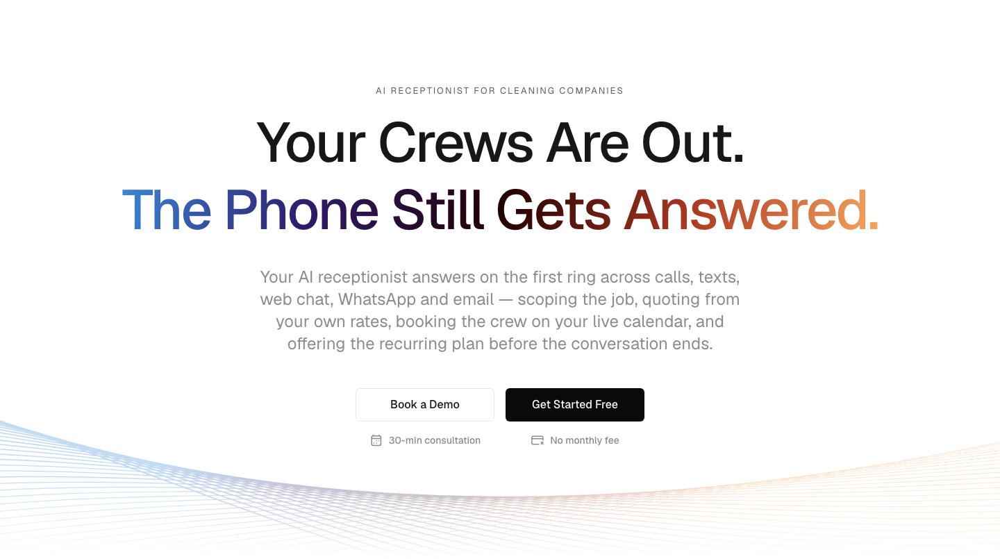

**2. The conversation** ← *new block.* A missed call at 7:42 becomes a booked job at 7:44. One thread crossing phone, SMS and WhatsApp, with a note under each agent reply saying what it did inside your systems, and the record it created at the end. Nobody else in the category shows this.

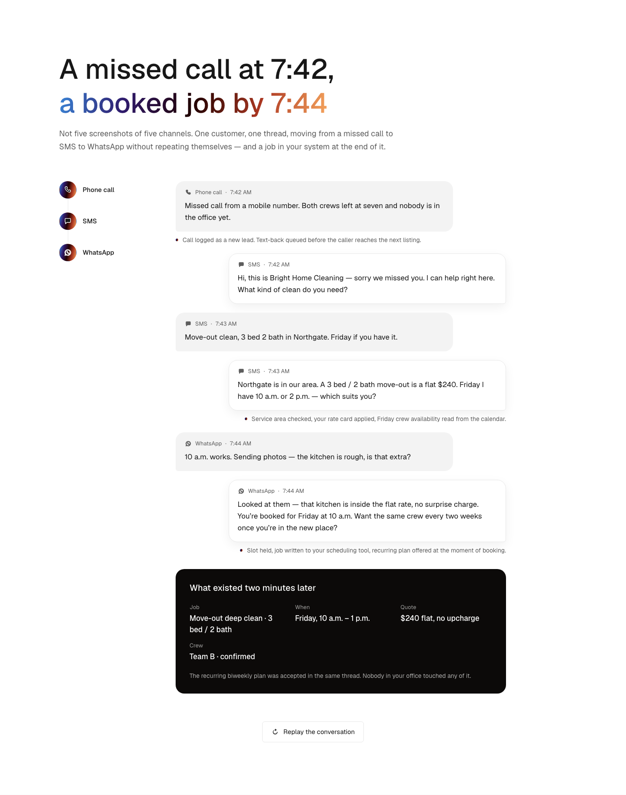

**3. Three bad options** — the status quo in the operator's own words, not a smug us-versus-them table.

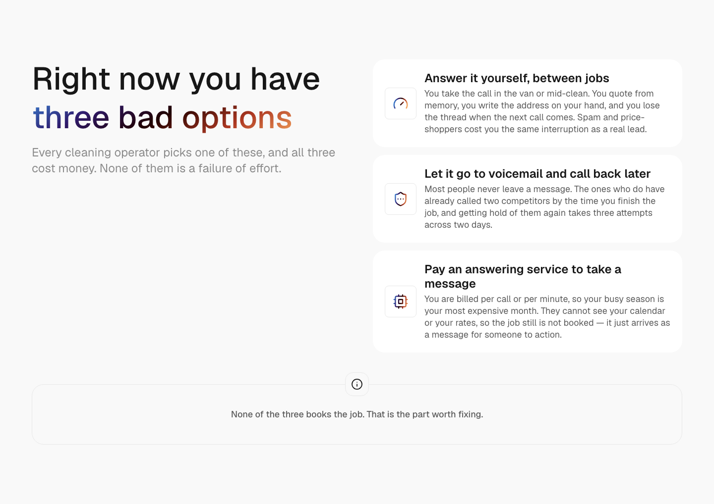

**4. What it runs** — the full lifecycle, including the three parts no competitor automates: selling the recurring plan, backfilling a cancellation, and following up after the visit.

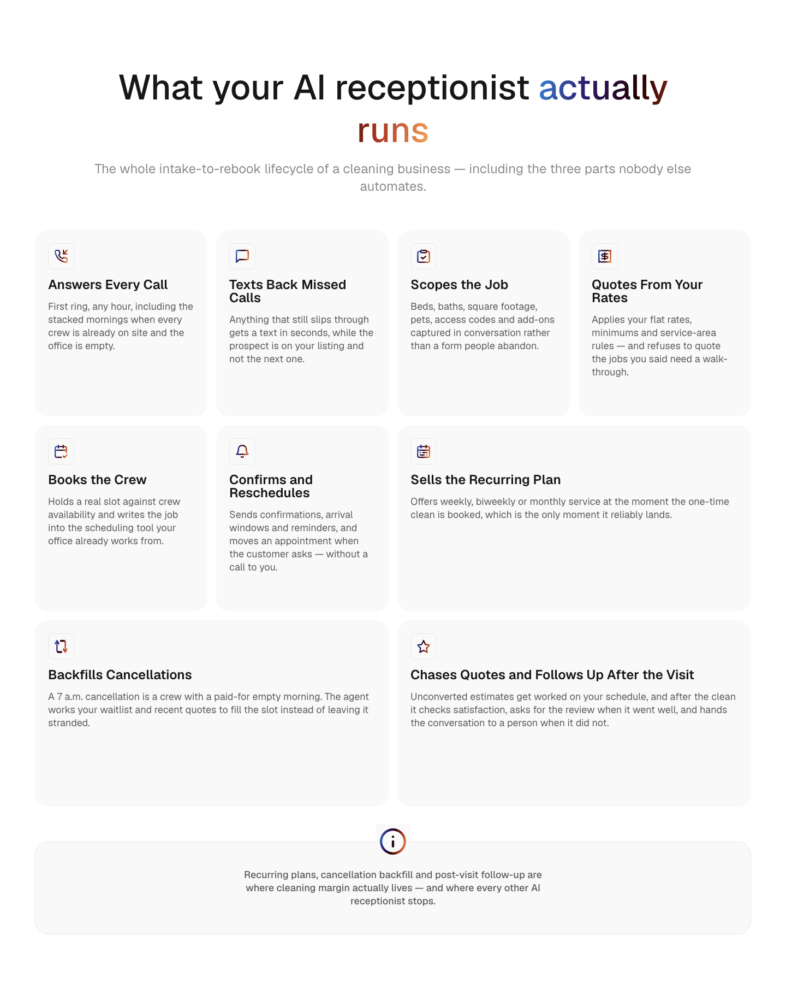

**5. What the silence costs** ← *new block.* Three sliders plus how often a client books. It leads with a number of clients rather than a number of dollars, shows the arithmetic, and says what it leaves out.

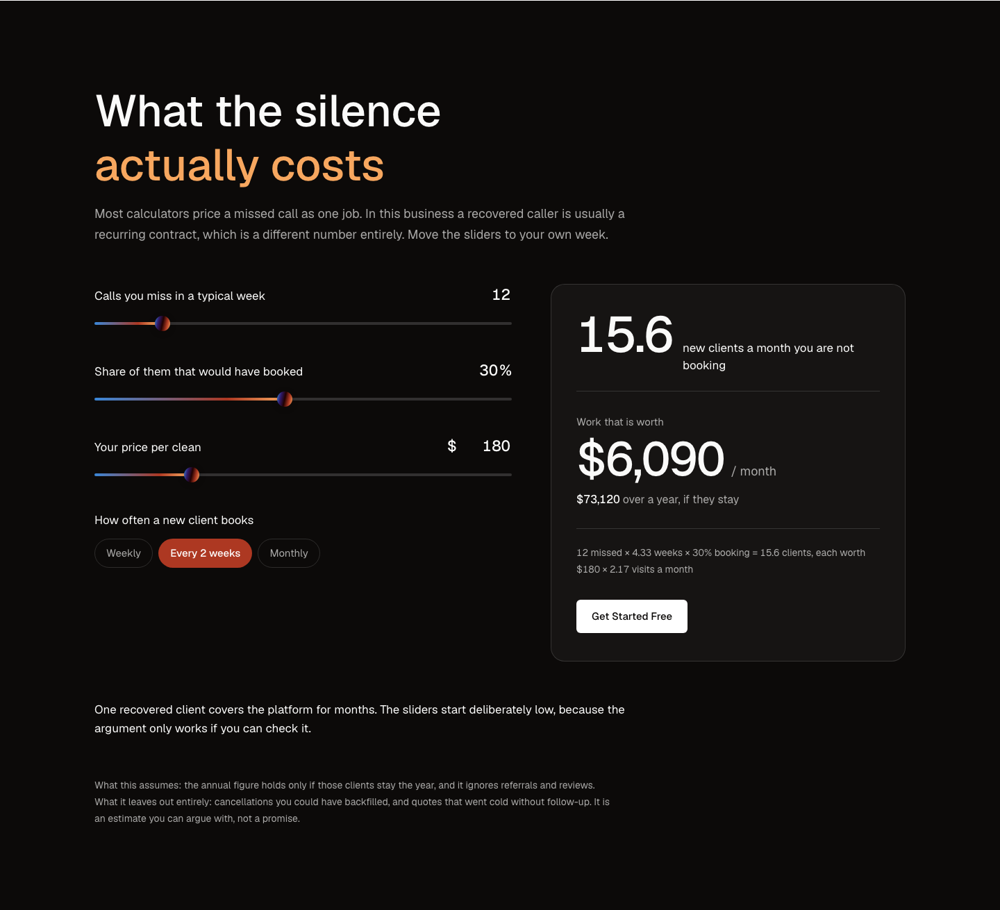

**6. Live in days** — three steps, no developer.

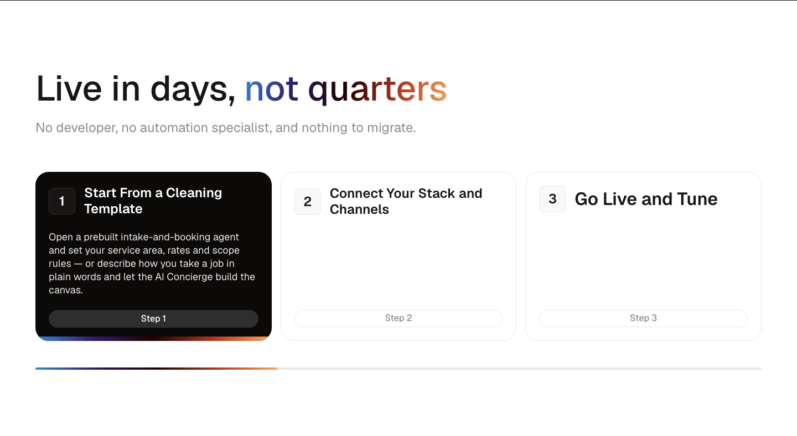

**7. Every channel** — five channels, each with a real cleaning conversation.

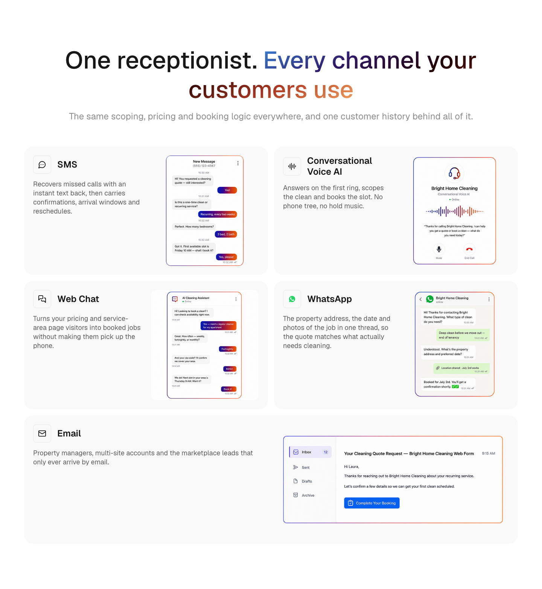

**8. Mid-page CTA**

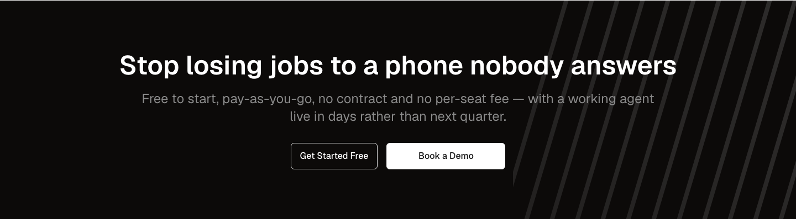

**9. Integrations** — four groups of five, each with what it is for, and lead sources included.

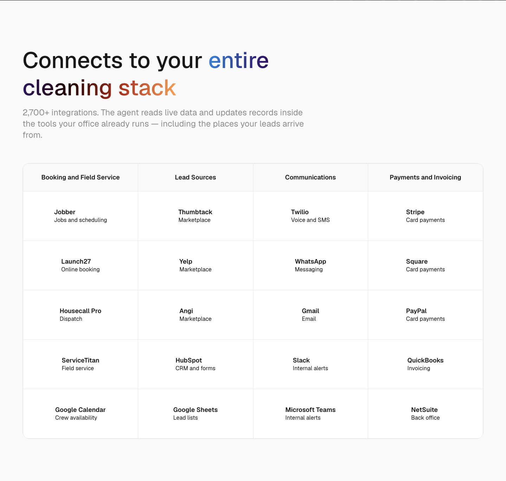

**10. Versus a standard answering service** — seven against seven.

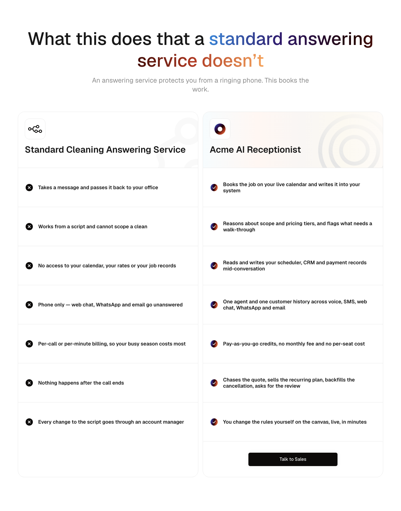

**11. The gap this closes** — four published survey figures with their sample sizes.

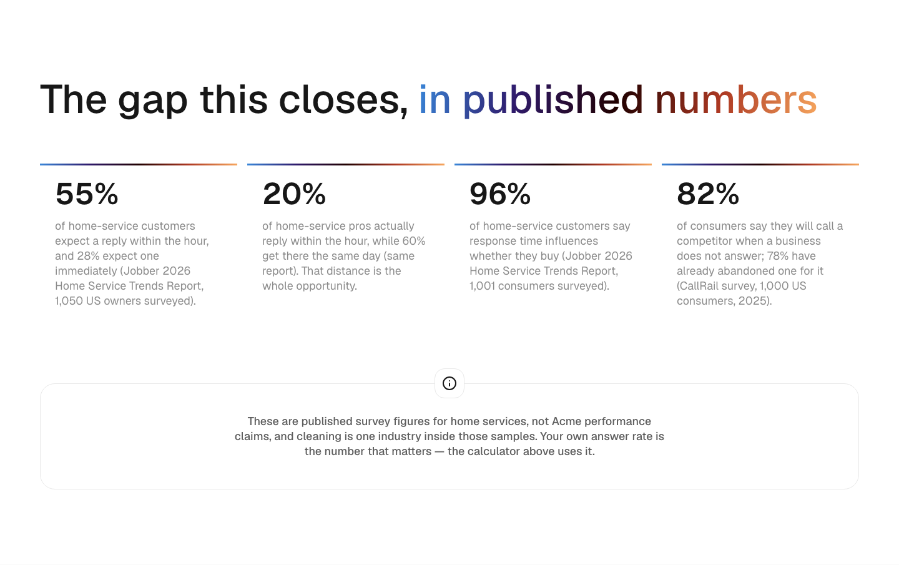

**12. Pricing** — with the sentence that matters: two recovered jobs cover a long stretch of credits.

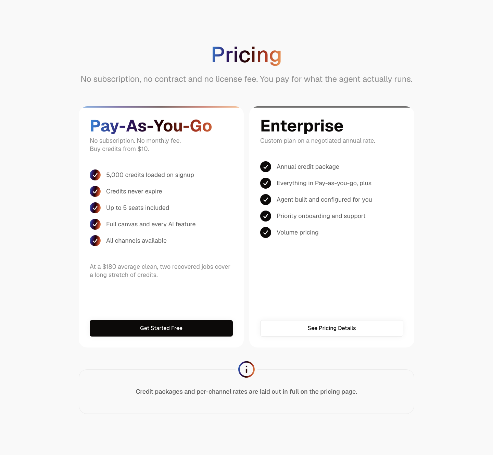

**13. Security** — written around what a cleaning company actually holds: addresses, gate codes, cards, recordings.

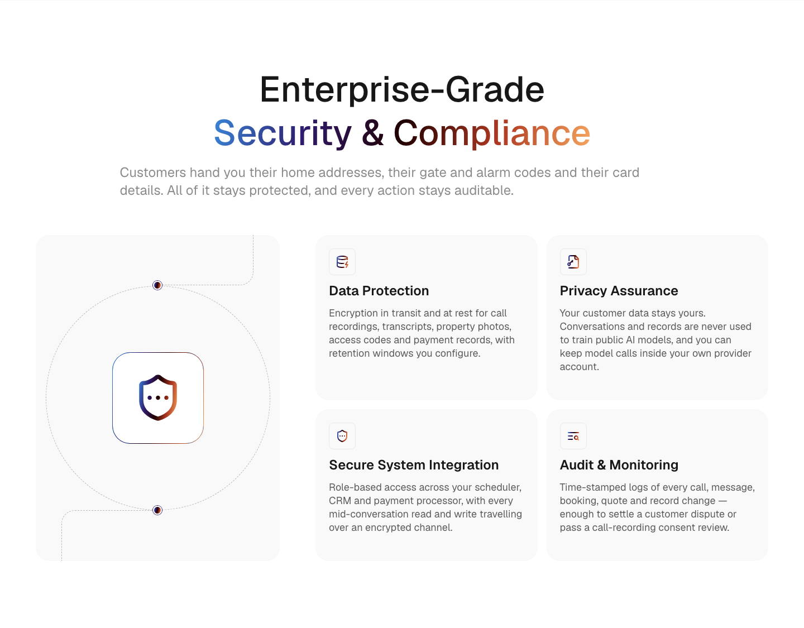

**14. FAQ** — thirteen questions, including the ones the category avoids: who pays when the agent misquotes a disaster job, can it backfill a 7 a.m. cancellation, how it avoids sending a crew across town, deposits, Spanish, and what happens when it gets something wrong.

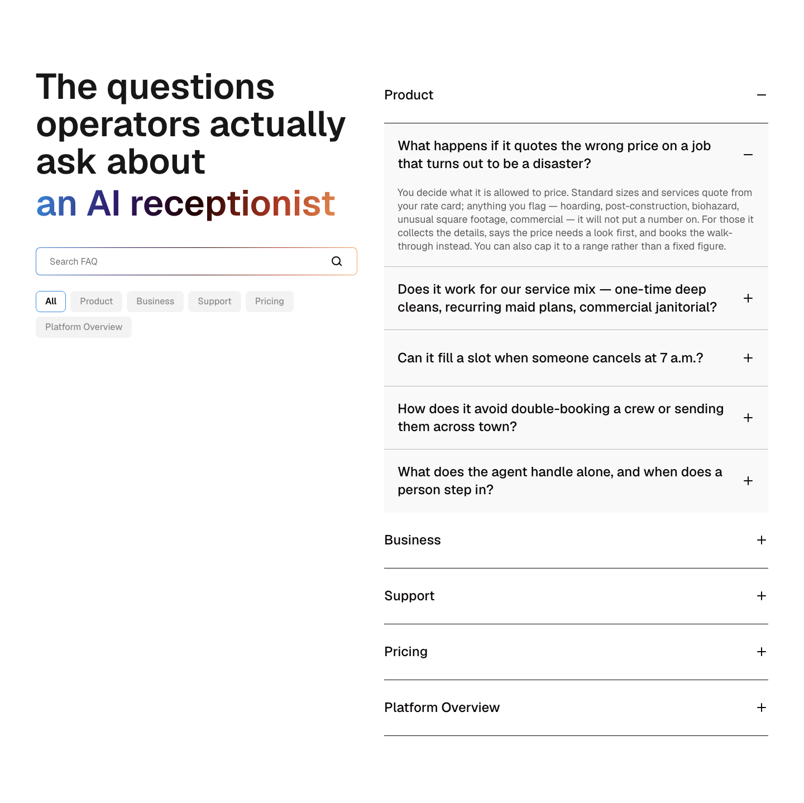

**15. Closing CTA**

Every block was also captured at 390px wide; the mobile set is in this folder (`*-mobile.png`).

## What the review caught

The independent review returned CHANGES REQUIRED with three blockers. Two of them would have shipped:

- **The visible formula did not produce the printed number.** The calculator showed "= 16 clients" and computed from 15.588, so a reader checking the arithmetic got $6,250 where the panel said $6,100 — which destroys the one thing the block exists for. Rounding now happens before multiplying: 15.6 × $180 × 2.17 = **$6,090**, exactly what is on screen.
- **`npm run typecheck` was failing.** Two causes: the showcase fixtures were written inline instead of following the repo's own convention, and a shared helper was shadowing each block's own `background` with a narrower one, making the dark variant impossible to type. Now 0 errors across 153 files.
- **Four authored fields were being silently dropped**, because the schema was missing them — the break-even sentence never reached the page.

Also fixed from the review: "One-time only" was arithmetically identical to "Monthly" (removed — the block is about recurrence); a number typed into a field was calculated at the slider's coarser step (type 33, compute 35); three real contrast failures against WCAG 1.4.3 and a focus ring at 1.92:1; white text on the light end of the brand gradient at ~2:1; the replay button hid itself and threw away keyboard focus; the speaker in the conversation was distinguishable only visually; a mid-page CTA had gone missing; and an unsourced "5 to 15 days" claim became a capability statement.

## Cost

| | |
|---|---|
| Whole session | ~794K tokens written, ~4.6M read into cache |
| Competitor research | ~88K tokens |
| Design-pattern research | ~102K tokens |
| Independent review | ~186K tokens |
| Human input needed | the brief, and the final publish decision |

The session figure covers everything from setting the repo up locally to building the generation system itself, an earlier page, an audit of the existing page, and this one. The research and the review are the parts worth paying for twice.

## Where things are

- Page (local): `http://localhost:4321/ai-receptionist-for-cleaning-companies-v2/`
- The two new blocks in the showcase: `http://localhost:4321/blocks-9/`
- Page data: `data/ai-page-generation/2026-08-ai-receptionist-cleaning-v2/pages.json`
- Block contracts: `ai/contracts/block-contracts.md`
- The system: `.claude/skills/create-page/`, `.claude/skills/create-block/`

The page is a **draft**. Publishing stays a human decision in Payload.

The hero was also rebuilt after review: the first pass used the homepage's `hero-extended` block and dropped the eyebrow, which is a different template. It now uses the standard `hero` block, and the keyword reaches the `<h1>` through the template's own mechanic rather than a workaround.

One open decision: the brief's "21x (HBR)" and "40% (Allclean)" figures were replaced, because the first traces only to paywalled second-hand citations and the second has no methodology. The replacements are cited surveys with sample sizes — but all four now describe the industry's problem and none describe the product. Restoring "24/7" and "under a minute", which are product characteristics rather than contested statistics, is probably right.
