# Текст → Страница: что делает система

Маркетолог пишет ТЗ. Система собирает страницу из утверждённой библиотеки блоков, проверяет её и отдаёт черновик в CMS. Ничего не рисуется с нуля и ничего не выдумывается: страница — это новая комбинация блоков, которые уже принадлежат дизайн-системе.

Ниже — один реальный прогон, блок за блоком.

## Какое ТЗ было на входе

Фрагмент настоящей задачи (TASK 1, от контент-команды):

> **Страница:** `/ai-receptionist-for-cleaning-companies/`
> **Тип:** индустриальный лендинг.
> **Главный ключевик:** «AI receptionist for cleaning companies» (H1, title, meta description, первые 100 слов, URL).
> **CTA (только утверждённые):** Book a Demo (подпись: 30-min consultation) + Get Started Free (подпись: No monthly fee).
> **Секции, по порядку:**
> 1. Hero — H1 «AI Receptionist for Cleaning Companies»; короткий подзаголовок до 10 слов + описание одним предложением про каналы и что агент делает от начала до конца; + 2 CTA
> 2. What Your AI Receptionist Agent Runs — 8–10 карточек жизненного цикла, по одной строке. Адаптировать под реальный рабочий процесс вертикали.
> 3. Challenge → Solution — 5 пар «боль/решение» … CTA под блоком.
> … всего 14 секций, последняя — FAQ на 9 вопросов.

## Как это прошло

1. **ТЗ → план.** Каждая запрошенная секция сопоставляется с блоком библиотеки по его назначению. Все 14 секций закрылись существующими блоками — рисовать новое не понадобилось.
2. **Написание контента.** Тексты пишутся под вертикаль: реальный процесс клининговой компании, а не общие слова про ИИ-агентов.
3. **Валидация.** Страница проверяется по схемам блоков ещё до попадания в CMS.
4. **Импорт и осмотр.** Черновик уходит в Payload, страница снимается на десктопе и мобильном, блок за блоком.
5. **Независимое ревью.** Отдельный проверяющий сверяет страницу с ТЗ и правилами дизайн-системы и выдаёт вердикт, а не пересказ.

## Результат, блок за блоком

**1. Первый экран** — ключевик в H1, обещание одной строкой, объяснение одним предложением, оба утверждённых CTA со своими подписями.

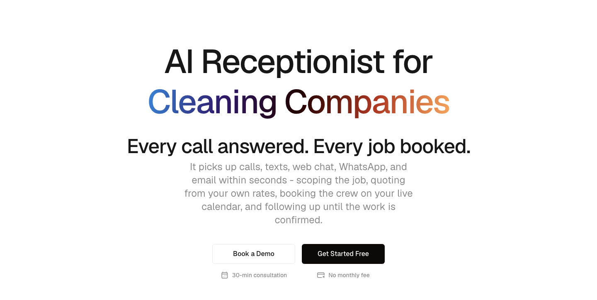

**2. Что делает агент** — 10 карточек жизненного цикла: от ответа на звонок до продажи регулярного плана.

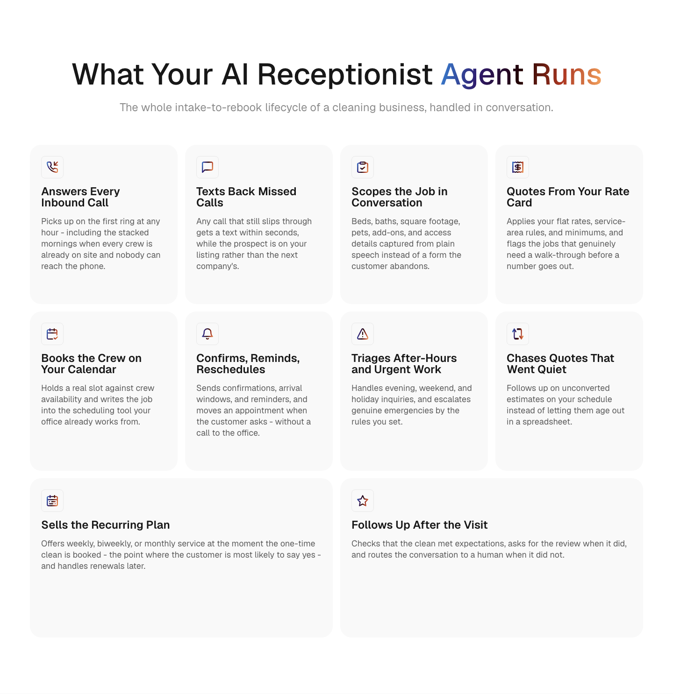

**3. Проблема → решение** — пять способов терять заказы и что меняется в каждом.

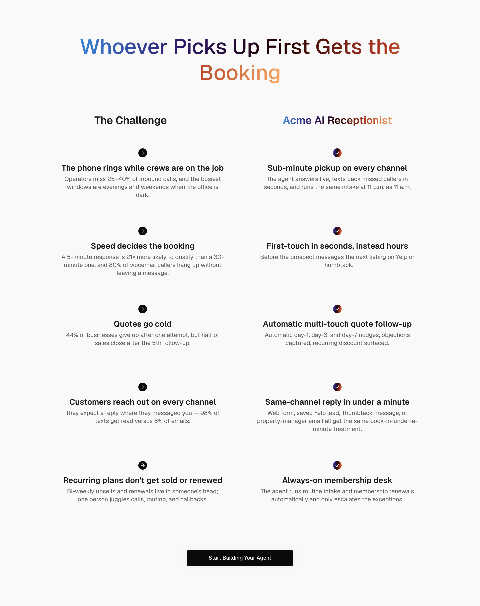

**4. Как это работает** — три шага, без разработчика, за дни, а не кварталы.

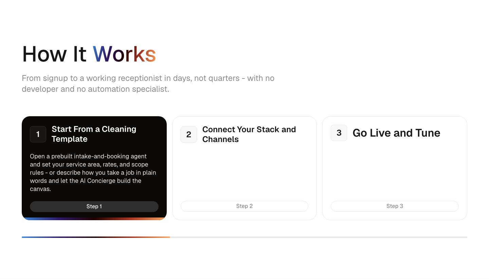

**5. В действии** — настоящий канвас продукта, с подписью, которая описывает именно то, что на нём есть.

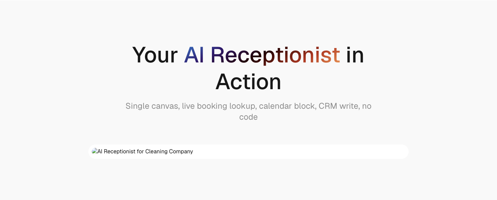

**6. Каждый канал** — пять каналов, у каждого свой мокап диалога про клининг.

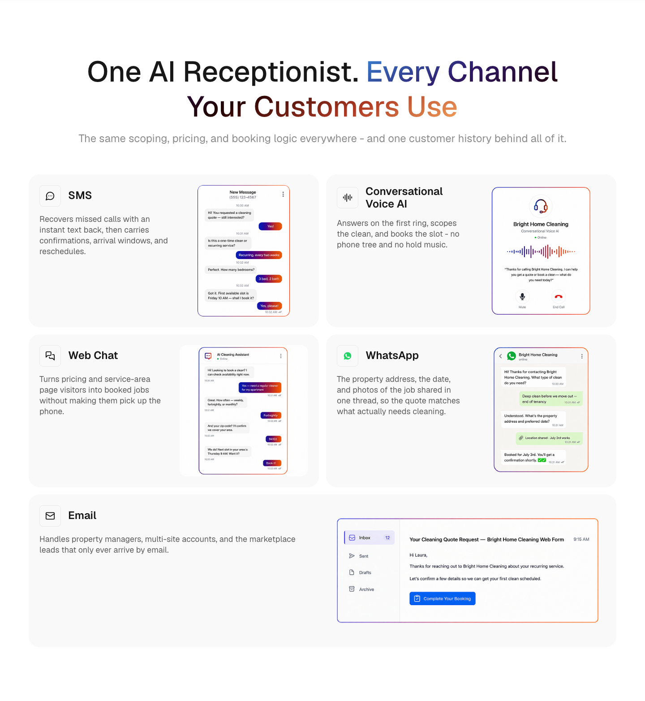

**7. CTA в середине страницы**

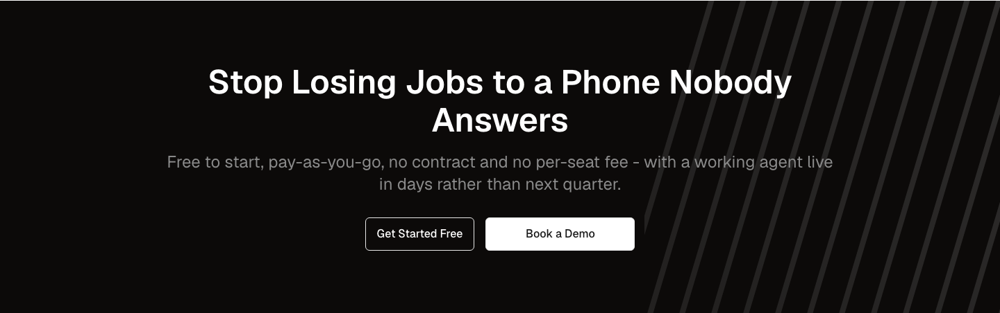

**8. Платформа под капотом** — пять возможностей платформы, интерактивно.

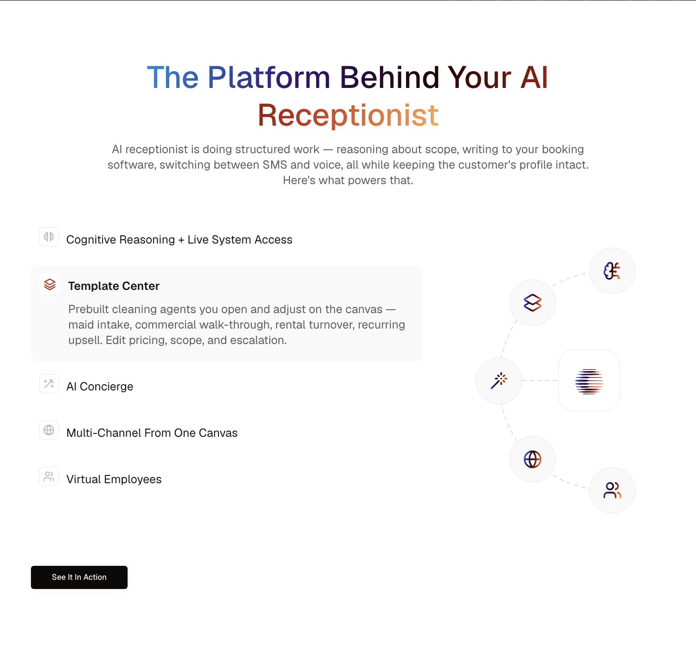

**9. Интеграции** — четыре группы по пять, у каждой указано, для чего она.

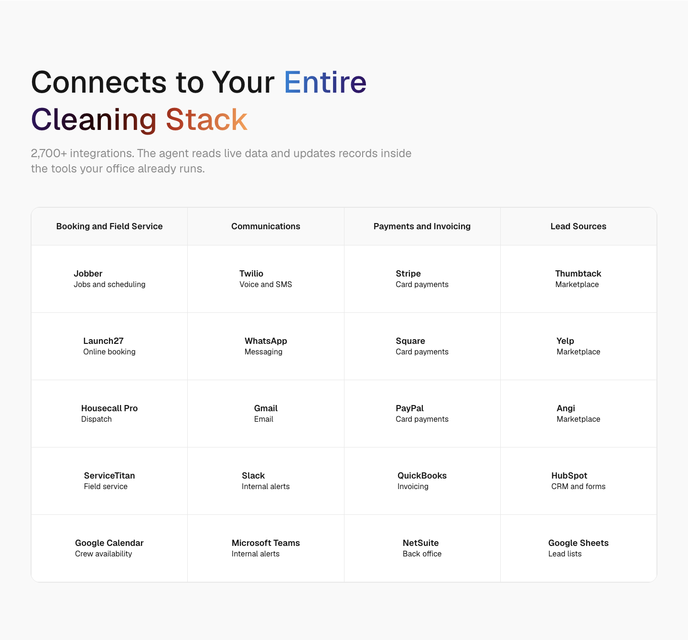

**10. Сравнение с обычной службой приёма звонков** — семь против семи.

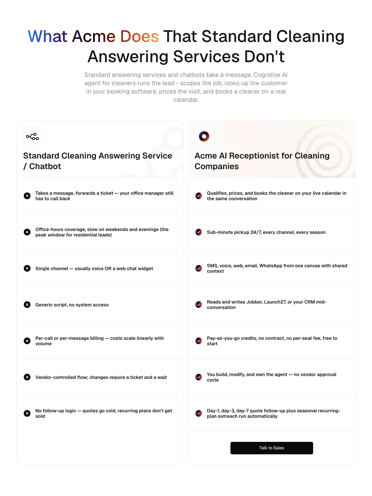

**11. Измеримый эффект** — четыре цифры из ТЗ, с источниками и оговоркой «ориентировочные результаты».

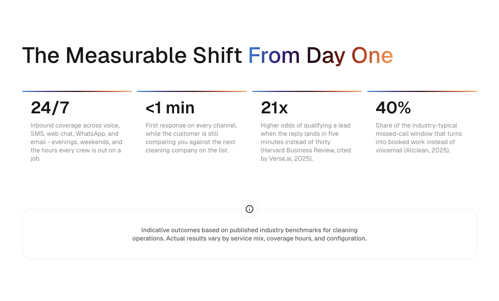

**12. Цены** — pay-as-you-go и enterprise, детали — ссылкой на страницу цен.

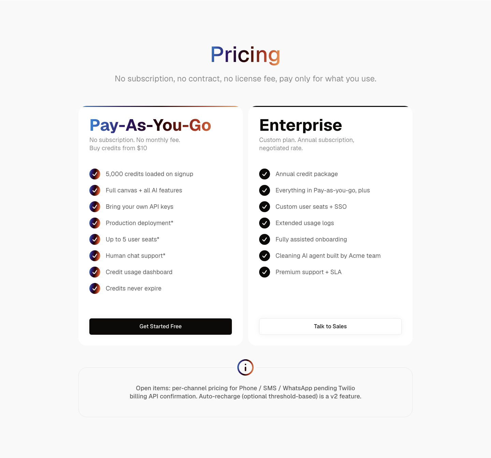

**13. Безопасность** — написано про то, что реально хранит клининговая компания: адреса, коды доступа, карты, записи звонков.

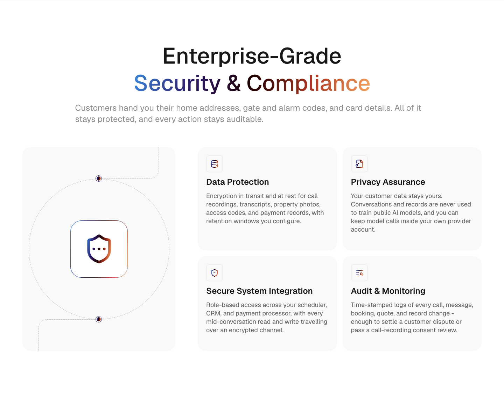

**14. FAQ** — девять вопросов, сгруппированы.

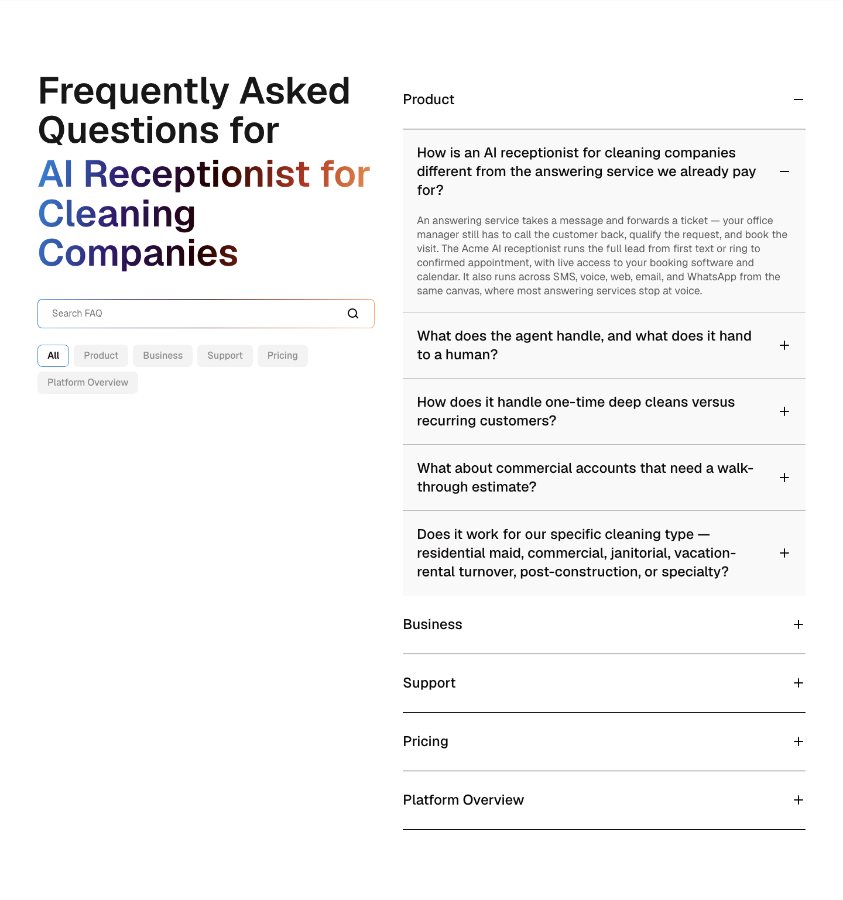

Каждый блок снят и на ширине 390px — мобильный набор лежит в той же папке (`*-mobile.png`).

## Что поймали проверки

Ценность не в том, что страница получилась, а в том, что четыре проблемы поймали до публикации:

- **H1 был бы неправильный.** В стандартном hero-блоке, если задан eyebrow, то именно **eyebrow** становится `<h1>`, а заголовок опускается до абзаца. Главное SEO-требование ТЗ провалилось бы незаметно. Решение: убрать eyebrow, тогда заголовок с ключевиком и есть H1.
- **Мокапы каналов показывали чужой бизнес.** По умолчанию блок каналов подставляет рекрутинговые скриншоты («Cleaner Position», «Continue Screening») на странице про ресепшен. Заменено клининговыми мокапами из медиатеки.
- **Таблица интеграций молча рендерилась пустой.** Баг платформы: элемент, у которого есть только название и нет логотипа, принимается за незаполненную ссылку и выбрасывается. Обошли, добавив каждой интеграции короткую строку назначения — так даже читается лучше.
- **Рваная сетка карточек.** Десять карточек в четырёхколоночной сетке оставляли обрубок в последнем ряду; две последние растянуты на две колонки — ряд закрылся.

Ни одна статистика, клиент, отзыв или интеграция не выдуманы. Единственные цифры на странице — те четыре, что дало ТЗ, вместе с источниками. Все названные интеграции уже упоминаются на сайте.

## Стоимость

| | |
|---|---|
| Вся сессия | ~509K токенов записано, ~2M прочитано из кэша |
| Независимое ревью | ~156K токенов |
| Время на эту страницу | около часа, без участия человека |
| Что требовалось от человека | ТЗ и финальное решение о публикации |

Цифра по сессии включает всё: локальный запуск репозитория, создание самой системы, ещё одну страницу и аудит существующей. Одна страница на уже настроенном окружении — небольшая доля от этого.

## Где что лежит

- Страница (локально): `http://localhost:4321/ai-receptionist-for-cleaning-companies-ai/`
- Данные страницы: `data/ai-page-generation/2026-08-ai-receptionist-cleaning-ai/pages.json`
- Сама система: `.claude/skills/create-page/` (собрать страницу), `.claude/skills/create-block/` (вырастить новый блок в дизайн-системе)

Страница — **черновик**. Публикация остаётся решением человека в Payload.
